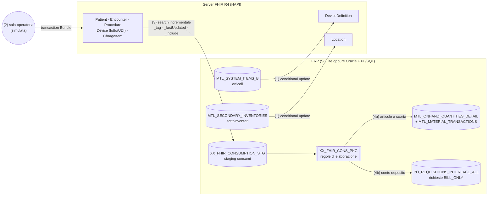

# ERP ↔ FHIR: logistica dei dispositivi medici in sala operatoria

Progetto dimostrativo di integrazione tra un **ERP in stile Oracle E-Business Suite / Fusion** e un **sistema clinico (EHR)** tramite lo standard **HL7 FHIR R4**.

Lo scenario è quello della supply chain ospedaliera: in sala operatoria il clinico documenta nella cartella clinica i dispositivi usati sul paziente. L'ERP deve:

- **scaricare il magazzino** per gli articoli a scorta (guanti, suture, teli);
- generare una **richiesta d'acquisto "bill-only"** per gli impianti in **conto deposito** (protesi), che vanno pagati al fornitore solo quando vengono impiantati.

Il disegno si ispira all'integrazione che Oracle documenta tra Fusion Cloud SCM e Oracle Health EHR: sincronizzazione articoli, consumi clinici che rettificano le giacenze, richieste bill-only per gli articoli non a scorta. Qui lo stesso processo è **reimplementato da zero e in forma semplificata**, su standard aperti. Non usa né replica codice o API Oracle.

> Tutti i dati (pazienti, aziende, GTIN, prezzi, lotti) sono **fittizi**. Non caricare mai dati reali su un server FHIR pubblico.

---

## Architettura



| # | Flusso | Direzione | Tecniche FHIR / ERP dimostrate |
|---|---|---|---|
| 1 | Anagrafiche | ERP → FHIR | `PUT DeviceDefinition?identifier=…` (**conditional update**, idempotente); UDI GS1 (`udiDeviceIdentifier`); sottoinventari → `Location` |
| 2 | Intervento chirurgico (simulato) | EHR → FHIR | **Bundle `transaction`** con riferimenti `urn:uuid`: `Patient`, `Encounter`, `Device` per lotto (`udiCarrier.carrierHRF`), `Procedure.usedReference`, un `ChargeItem` per consumo |
| 3 | Lettura consumi | FHIR → ERP | Ricerca **incrementale** (`_lastUpdated=gt…` con watermark), **paginazione**, `_include=ChargeItem:service`, lettura `Device` per `_id`; staging idempotente |
| 4 | Elaborazione ERP | ERP | Package **PL/SQL** `XX_FHIR_CONS_PKG`: controllo giacenza per lotto, scarico, richiesta bill-only con prezzo di contratto e fornitore del conto deposito; **gestione errori per riga** (`SAVEPOINT`) con nuovo tentativo automatico |

### Mapping principale

| ERP | FHIR R4 | Note |
|---|---|---|
| `MTL_SYSTEM_ITEMS_B.SEGMENT1` | `DeviceDefinition.identifier` | sistema `http://erp.example.org/fhir/sid/item-number` |
| `MTL_SYSTEM_ITEMS_B.GTIN` | `DeviceDefinition.udiDeviceIdentifier.deviceIdentifier` | issuer `http://hl7.org/fhir/NamingSystem/gs1-di` |
| `MTL_SECONDARY_INVENTORIES` | `Location` | il sottoinventario è l'identificativo |
| lotto del consumo | `Device.lotNumber`, `Device.udiCarrier.carrierHRF` | `(01)GTIN(10)LOTTO` |
| quantità consumata | `ChargeItem.quantity` | un `ChargeItem` per riga di consumo |
| intervento / ricovero | `ChargeItem.service` → `Procedure`, `ChargeItem.context` → `Encounter` | riportati nella nota della richiesta bill-only |
| `STOCK_ENABLED_FLAG` | — (regola ERP) | `Y` scarico di magazzino · `N` richiesta bill-only |

Le tabelle ERP sono **semplificate**: hanno i nomi delle tabelle EBS R12 ma solo le colonne utili alla demo. Le tabelle custom seguono la convenzione `XX_`.

---

## Avvio rapido (Windows, SQLite)

Serve Python 3.9 o superiore.

```powershell
git clone https://github.com/<tuo-utente>/erp-fhir-healthcare-supply.git
cd erp-fhir-healthcare-supply
python -m venv .venv
.venv\Scripts\activate
pip install -r requirements-dev.txt

cd src
python -m erpfhir check     # verifica la connessione a hapi.fhir.org
python -m erpfhir demo      # esegue i flussi 1-4 e stampa il report
```

Per vedere anche la gestione degli errori: `python -m erpfhir demo --with-error`. Aggiunge un consumo di 999 suture che supera la giacenza: la riga finisce in errore, le altre vengono elaborate.

Comandi singoli: `init-db`, `sync-master`, `simulate-surgery`, `import`, `process`, `report`.

Su Linux/macOS: `source .venv/bin/activate`.

I dati della demo sono contrassegnati con un `meta.tag` univoco, generato al primo avvio e salvato in `.demo_tag`. Così si possono ritrovare sul server pubblico. Per esempio:

```
https://hapi.fhir.org/baseR4/ChargeItem?_tag=http://erp.example.org/fhir/CodeSystem/demo-run|<il-tuo-tag>
```

Il server HAPI pubblico è condiviso e viene azzerato periodicamente. Se i dati spariscono, basta rilanciare `demo`.

## Backend Oracle (opzionale)

1. Avvia un Oracle Database, per esempio Oracle Database Free.
2. Crea un utente dedicato.
3. Imposta in `.env` i valori `DB_BACKEND=oracle`, `ORACLE_USER`, `ORACLE_PASSWORD` e `ORACLE_DSN`.
4. Esegui:

```powershell
cd src
python -m erpfhir init-db   # esegue sql/oracle/01_schema.sql, 03_xx_fhir_cons_pkg.sql, 02_seed.sql
python -m erpfhir demo
```

Gli script si possono eseguire anche da SQL*Plus o SQLcl: ogni istruzione termina con `/`. Con Oracle, l'elaborazione (flusso 4) chiama `XX_FHIR_CONS_PKG.PROCESS_STAGING`. Con SQLite, la stessa logica è replicata in `SqliteErp.process_staging()`.

## Test

```powershell
python -m pytest -q
```

I test girano **offline**. Usano SQLite e un server FHIR simulato in memoria (`tests/fake_fhir.py`), che **valida ogni risorsa ricevuta** con i modelli di [`fhir.resources`](https://pypi.org/project/fhir.resources/). I modelli sono R4B, strutturalmente equivalente a R4 per le risorse usate qui.

I test coprono:

- la validità FHIR delle risorse prodotte;
- l'intero flusso: giacenze, movimenti, richieste bill-only, errore di giacenza;
- la paginazione;
- l'idempotenza: rileggere e rielaborare non duplica nulla;
- la lettura incrementale;
- l'isolamento tra due copie del progetto sullo stesso server.

**Stato della verifica:**

- I test offline passano.
- Le risorse sono validate strutturalmente.
- Verificato contro il server pubblico **HAPI FHIR 8.13 (FHIR R4 4.0.1)** il 27/10/2026: flusso completo con i risultati attesi, e una seconda esecuzione di `import` e `process` senza duplicati.
- Il backend Oracle/PL-SQL **va ancora provato** su un database reale.

## Struttura

```
sql/sqlite/            schema e dati di esempio (SQLite)
sql/oracle/            schema, dati, package PL/SQL XX_FHIR_CONS_PKG
src/erpfhir/
  config.py            configurazione e NamingSystem
  fhir_client.py       client REST FHIR (conditional update, transaction, search paginata)
  mappers.py           mapping ERP <-> FHIR (funzioni pure)
  db.py                repository ERP (SQLite / Oracle)
  flows.py             i 4 flussi
  __main__.py          riga di comando
tests/                 server FHIR simulato + test end-to-end
```

## Possibili estensioni

- Profili FHIR italiani (HL7 Italia) e `StructureDefinition` dedicati agli articoli.
- `ChargeItemDefinition` per i prezzi di contratto.
- Esecuzione schedulata dei flussi 3-4 con un orchestratore, per esempio Oracle Integration Cloud.
- Riconciliazione delle richieste bill-only con ordine e fattura (ciclo passivo, NSO).
- Autenticazione OAuth2 / SMART Backend Services verso un EHR reale.

## Riferimenti

- [HL7 FHIR R4](https://hl7.org/fhir/R4/): risorse [DeviceDefinition](https://hl7.org/fhir/R4/devicedefinition.html), [Device](https://hl7.org/fhir/R4/device.html), [ChargeItem](https://hl7.org/fhir/R4/chargeitem.html), [Procedure](https://hl7.org/fhir/R4/procedure.html), [transaction](https://hl7.org/fhir/R4/http.html#transaction), [conditional update](https://hl7.org/fhir/R4/http.html#cond-update)
- Oracle: [Synchronize Items, Item Usage, and Bill-only Requisitions Between Oracle Cloud ERP and Oracle Health (26A)](https://docs.oracle.com/en/cloud/saas/readiness/scm/26a/plm26a/26A-plm-wn-f41950.htm)
- [HAPI FHIR public test server](https://hapi.fhir.org/)

---

Autore: **Francesco Paolo Raspa**, Senior Oracle ERP Consultant (E-Business Suite R12). Licenza MIT.
